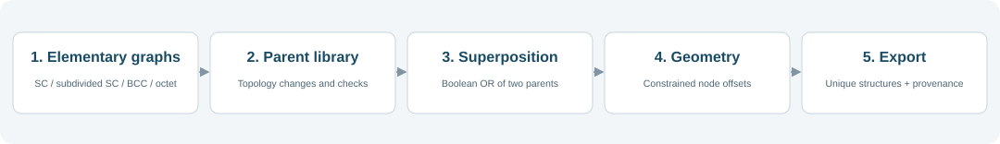
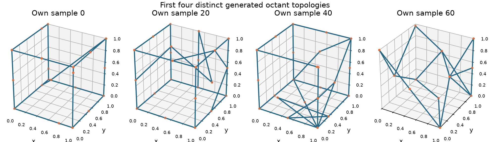
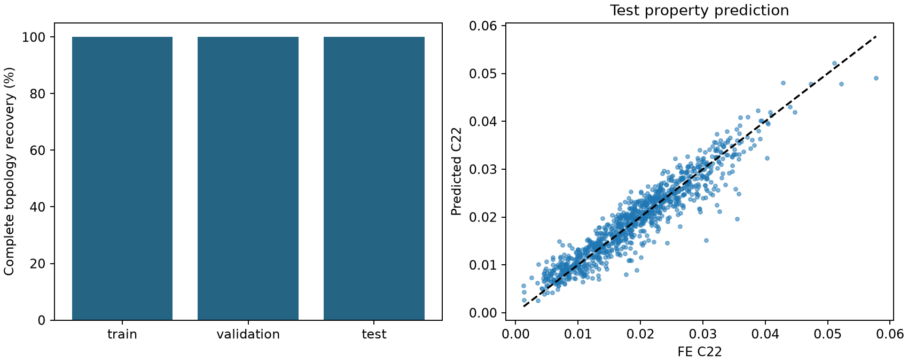

# Own-data Truss Modelling and Latent Design

A reproducible workflow for generating truss structures, calculating FE stiffness labels, training a joint VAE/predictor from scratch, and checking latent-space stiffness searches. Generation and the VAE architecture are adapted from [UnifyingTrussDesignSpace](https://github.com/li-zhengz/UnifyingTrussDesignSpace); the FE solver and compact experiment runners are independent implementations. No author checkpoint or published final structure dataset is required.





## What is included?

- `generate.py`: one readable entry point for generation, checks and export.
- `upstream.py`: 12 selected upstream functions, with their original AST bodies retained; source attribution and MIT license are included.
- `data/`: the four upstream elementary adjacency graphs and the 27 reference-node coordinates.
- `preview.py`: a small plotting helper.
- `example_data/`: an actually generated, checked 2,000-structure example with provenance.
- `fe.py`, `label.py`: independent periodic Timoshenko FE and batch labelling.
- `models.py`, `train.py`, `evaluate.py`: upstream VAE architecture, own stiffness head, scratch training and evaluation.
- `optimise.py`: bounded latent E22 search using the frozen own-trained model, followed by actual FE checks.
- `datasets/own_10000/`: 10,000 checked own structures, FE labels, fixed splits and provenance.
- `docs/`: project landing page.

The original `example_data/` remains a geometry-only 2,000-structure example. The new reference dataset has **10,000 distinct structures across 499 final topologies**, with actual FE labels for every row. See [EXPERIMENT.md](EXPERIMENT.md) for the fixed training and search protocol.

## Quick start

Use Python 3.10 or newer, then run from this folder:

```bash
python -m venv .venv
source .venv/bin/activate
python -m pip install -r requirements.txt
python generate.py --attempts 1500 --pairs 500 --variants 20 --seed 202611081 --output generated_10000
python label.py generated_10000/structures.npz
python train.py generated_10000 --output results/new_fit
python optimise.py generated_10000 results/new_fit --output results/new_search
```

The commands reproduce the 10,000-row reference configuration. Plain `python generate.py` retains the smaller 2,000-row generation defaults. Existing output folders and labels are preserved; choose fresh paths for an independent run. `preview.py` draws generated octant graphs.

The dependency versions used to verify the supplied example are in `requirements-tested.txt`.

## Generation steps

1. Load the upstream SC, subdivided SC, BCC and octet seed graphs on 27 candidate nodes in one octant.
2. Apply the upstream stochastic topology changes and repair rules. Retain connected parent graphs meeting the upstream boundary check, then remove duplicate topologies.
3. Enumerate unordered parent pairs, allowing self-pairs. Check the connectivity of the union of **both** parents and sample valid pairs without replacement.
4. Combine the two parent adjacencies with Boolean OR. For each selected pair, call the upstream node-perturbation function independently 20 times.
5. Resample duplicate complete geometry draws, with a bounded retry count and a recorded duplicate counter. Verify connectivity of active nodes, boundary spanning, union provenance, unique complete structures, allowed offset directions, coordinate bounds and nonzero beam lengths. Save the arrays, seeds, parent IDs and per-sample checks.

Vertex positions are fixed. Edge nodes move only along their edge, face nodes within their face, and the body node in three dimensions. The representation keeps 27 candidate slots; inactive slots are not connected graph nodes. This exports the **octant**, not an already mirrored full-cell FE mesh. Beam interiors do not become joints merely by crossing.

## Output arrays

```python
import numpy as np

with np.load("example_data/structures.npz") as data:
    adjacency = data["adjacency"]  # (2000, 27, 27), symmetric, zero diagonal
    offsets = data["offsets"]      # (2000, 27), movable natural-coordinate features
    positions = data["positions"]  # (2000, 27, 3), Cartesian coordinates
```

`raw_offsets` stores `(N, 27, 3)` natural offsets; these are **not generally Cartesian displacements**. `reference_positions` stores the reference arrangement. The export applies one explicit global x/y exchange to both coordinates and offset components, matching our existing ML exports. It does not alter adjacency, lengths or connectivity. `generate.check` verifies the coordinate conversion using the inverse exchange and the original upstream mapping.

`parents.npz`, `raw_attempts.npz`, `selected_pairs.csv` and `provenance.csv` retain the generation history. `summary.json` reports actual unique counts, rather than assuming every selected pair produces a new topology.

## FE, training and search

FE uses circular linear Timoshenko beams, six periodic engineering-strain cases, Es=1, nu=.3 and relative density .15. Explicit graph joints are preserved. Each label has nine orthotropic stiffness components, a 6-by-6 matrix, a source ID and a validity flag. The independent solver is not the authors' original ae108 study implementation.

The new random sample split is fixed at 8,000 training, 1,000 validation and 1,000 test rows, seed 20261108. Normalization uses training labels only. Validation selects a checkpoint; the test partition does not tune the model. Topology overlap is measured and reported rather than prohibited.

Training starts from random weights. The 48-dimensional VAE is jointly fitted with a 48–128–128–9 property head. Evaluation separates full-matrix accuracy, complete topology recovery, coordinate error, stiffness error and actual FE checks of reconstructed structures. The native upstream shared-noise sampler and its logvar/KL convention are retained and documented.

Latent search freezes these own-trained weights. Only the latent variables change. Eight source topologies, fixed settings, a trust box and a post-training FE budget are specified before search. Predicted improvement is checked against actual FE, and gains are measured against both the original structure and its decoded starting reconstruction. A fixed target E22=.15 is a search reference, not an attained-performance claim. Non-positive predicted stiffness, failed FE and non-improving results remain visible.

## Reference reconstruction result

The 10,000-row own-data run used 8,000 training, 1,000 validation and 1,000 test examples. A single scratch fit ran for 200 epochs; validation selected epoch 160.

| Test metric | Actual result |
| --- | ---: |
| Exact topology, encoder-mean decoding | 1,000 / 1,000 |
| Exact topology, one native sampled decoding | 998 / 1,000 |
| Full adjacency accuracy, native sampled decoding | 99.9986% |
| C22 prediction R2 | 0.8932 |
| Positive-definite predicted stiffness matrices | 944 / 1,000 |
| Prespecified reconstructed test structures passing FE | 12 / 12 |
| Median absolute E22 change in those twelve reconstructions | 0.545% |

All test topologies occur in training; complete input geometries are distinct. This is random sample evaluation, not unseen-topology generalization. Coordinates are approximate and stiffness predictions can be non-physical; connection recovery alone does not establish mechanical accuracy.



[Training report](results/own_10000/REPORT.md) · [Saved own-trained weights](results/own_10000/model.pt) · [Verification](results/own_10000/verification.json).

## What was adapted?

This is a **code-derived, smaller-scale generation workflow**, not a recreation of the authors' complete historical dataset.

- The original pair-validation loop reads the first parent index twice. Our runner checks the actual union of the two different parent indices.
- We use fixed NumPy/Python seeds, serial execution and smaller configurable counts. The original release's 1,000 unused NumPy draws are retained to preserve RNG continuity with our archived run.
- We extract only the functions used by this route. Their bodies are unchanged; their provenance hashes are in `upstream_functions.json`.
- We add independent checks and provenance export. No VAE or stiffness predictor is used to select accepted examples.

The public code generates geometry **after pairing**. The paper's prose describes geometry perturbation within the preliminary library **before superposition**, and describes inserting joints at beam intersections. We follow the selected executable graph-generation route and preserve explicit graph connections. Therefore, the package should be cited as **adapted from the public code**, not as a literal reproduction of every paper-described step. No maximum perturbed-beam-length filter or intersection welding is silently added.

See [PROVENANCE.md](PROVENANCE.md) and [VERIFICATION.md](VERIFICATION.md).

## Source and citation

Li Zheng, Konstantinos Karapiperis, Siddhant Kumar and Dennis M. Kochmann. *Unifying the design space and optimizing linear and nonlinear truss metamaterials by generative modeling*. Nature Communications 14, 7563 (2023). [Paper](https://doi.org/10.1038/s41467-023-42068-x) · [Original code](https://github.com/li-zhengz/UnifyingTrussDesignSpace).

Upstream revision: `8bb0aa401d6b5c2560e8d2121f11e2e0a7c26f77`. Upstream MIT copyright and license are retained in [LICENSE](LICENSE). This adaptation is not the authors' official repository.
