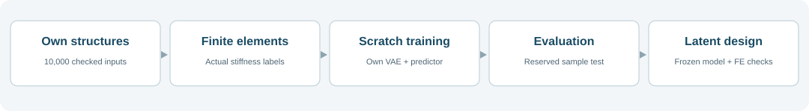
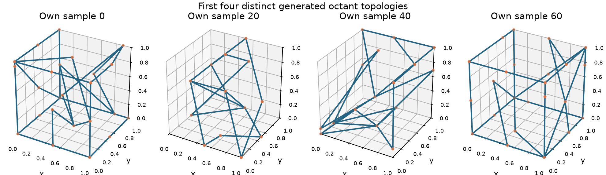

# Own-data Truss Modelling and Latent Design

A reproducible workflow from generated truss geometry to finite-element stiffness labels, a model trained from scratch, and FE-checked latent searches. Generation and VAE architecture are adapted from Zheng et al.; the FE solver and experiment runners are independent implementations. No author checkpoint is used.



## Own dataset and finite elements

The reference run generated **10,000 distinct complete structures across 499 final topologies**, from 1,500 parent attempts and 500 selected parent pairs. One duplicate geometry draw was explicitly resampled. There is no exact complete-structure overlap with the earlier 2,000-row example.

All 10,000 structures have actual FE labels. The model uses periodic linear circular Timoshenko beams, Es=1, nu=.3 and relative density .15. Graph connections are explicit; crossing beam interiors do not automatically become joints.



## Train and evaluate our own model

A single scratch joint VAE/predictor fit used 8,000 training, 1,000 validation and 1,000 test rows. Validation selected epoch 160 of 200. The test set did not choose settings or checkpoints.

| Test quantity | Actual result |
| --- | ---: |
| Exact topology, mean decoding | 1,000 / 1,000 |
| Exact topology, one native sampled decoding | 998 / 1,000 |
| Sampled full-adjacency accuracy | 99.9986% |
| C22 prediction R2 | 0.8932 |
| Positive-definite predicted C | 944 / 1,000 |
| Prespecified reconstructed geometries passing FE | 12 / 12 |
| Median absolute E22 change in the twelve checks | 0.545% |

All test topologies occur in training, while full geometry samples are distinct. This is not a topology-disjoint generalization benchmark. Exact connections do not imply exact positions or stiffness. Predictor matrices are not always physically valid.

The repository contains the own-trained checkpoint, executable training/evaluation code, metrics and a notebook that replays a preselected test example.

## Latent stiffness search

Freeze the own-trained VAE and stiffness predictor, adjust only the latent code, decode each candidate and check actual FE stiffness. Five of eight searches exceeded their own original source; seven had FE-valid selected endpoints. The largest relative improvement was **13.30%**, from E22/Es=0.0475556 to 0.0538794. Its connection topology was unchanged.

The highest absolute endpoint was a different candidate, E22/Es=0.0539888. This remains below the best original training structure (0.0582523). Two endpoints degraded; one was disconnected. These are local design improvements, not a global optimum or faster-convergence result. No stress constraint is imposed.

All outcomes, settings, saved latent codes, verification and figures are in the repository. The largest relative-gain example was replayed from its saved own-model latent and independently FE-checked.

## Reproduce

```bash
python -m pip install -r requirements.txt
python generate.py --attempts 1500 --pairs 500 --variants 20 --seed 202611081 --output generated_10000
python label.py generated_10000/structures.npz
python train.py generated_10000 --output results/new_fit
python optimise.py generated_10000 results/new_fit --output results/new_search
```

[Open the repository for code, data, reports and the executed notebook]({{ site.github.repository_url }}).

## Source

Zheng, L., Karapiperis, K., Kumar, S. & Kochmann, D. M. *Unifying the design space and optimizing linear and nonlinear truss metamaterials by generative modeling*. Nature Communications **14**, 7563 (2023).

[Paper](https://doi.org/10.1038/s41467-023-42068-x) · [Original code](https://github.com/li-zhengz/UnifyingTrussDesignSpace)

The public-code route and implementation adaptations are documented separately. This does not claim exact recreation of the authors' historical dataset or ae108 FE configuration. Upstream MIT attribution is retained; this is not the authors' official repository.
